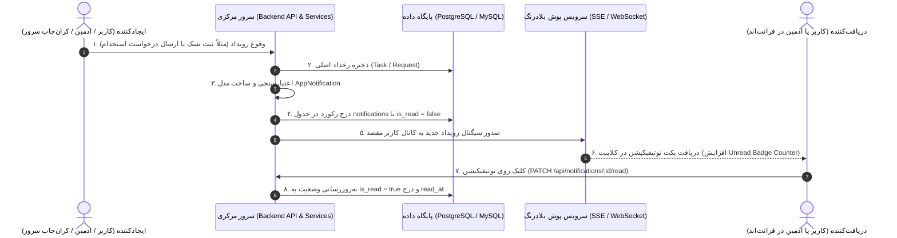

# سند جامع معماری، ارسال، دریافت و ذخیره‌سازی سیستم اعلان‌ها (Notifications)
### سامانه جامع پورتال سازمانی یورو اسلات پارس و نانو پالایش (Euroslot Pars & NPCeram)

این سند مرجع فنی و راهنمای کامل معماری سیستم اعلان‌ها (Notifications System) است که نحوه **تولید (Trigger & Creation)**، **ذخیره‌سازی در دیتابیس (Storage & Persistence)**، **ارسال زنده به کلاینت‌ها (Real-Time Dispatching)** و **دریافت و نمایش در فرانت‌اند (Reception & Consumption)** را به تفکیک برای دو نقش **مدیر/ادمین (Admin)** و **کاربر/پرسنل عادی (User/Staff)** تشریح می‌کند.

---

## فهرست مطالب
1. [مفاهیم پایه و تفاوت نوتیفیکیشن سیستم با Toast](#۱-مفاهیم-پایه-و-تفاوت-نوتیفیکیشن-سیستم-با-toast)
2. [چرخه حیات کامل یک نوتیفیکیشن (Life Cycle)](#۲-چرخه-حیات-کامل-یک-نوتیفیکیشن-life-cycle)
3. [تفکیک سناریوها برای ادمین و کاربر](#۳-تفکیک-سناریوها-برای-ادمین-و-کاربر)
4. [معماری پایگاه داده و مدل ذخیره‌سازی (Database Schema)](#۴-معماری-پایگاه-داده-و-مدل-ذخیره‌سازی-database-schema)
5. [مشخصات کامل اندپوئینت‌های سرور (API Specification)](#۵-مشخصات-کامل-اندپوئینت‌های-سرور-api-specification)
6. [ارتباط زنده و آنی (Real-Time Push via SSE / WebSocket)](#۶-ارتباط-زنده-و-آنی-real-time-push-via-sse--websocket)
7. [یکپارچگی در فرانت‌اند (Frontend Service & Popover)](#۷-یکپارچگی-در-فرانت‌اند-frontend-service--popover)
8. [نمونه کدهای آماده بک‌اند (Backend Reference Implementations)](#۸-نمونه-کدهای-آماده-بک‌اند-backend-reference-implementations)
9. [نمونه تست‌های cURL](#۹-نمونه-تست‌های-curl)

---

## ۱. مفاهیم پایه و تفاوت نوتیفیکیشن سیستم با Toast

در طراحی سامانه‌های سازمانی، تفکیک دقیق بین دو لایه اعلان الزامی است:

| شاخص | پیام موقت مرورگر (Toast / Flash Message) | اعلان ماندگار سامانه (System Notification) |
| :--- | :--- | :--- |
| **محل ذخیره** | حافظه موقت کلاینت (Browser RAM) | **پایگاه‌داده متمرکز سرور (Database Table)** |
| **طول عمر** | ۳ تا ۵ ثانیه | دائمی تا زمان خوانده‌شدن یا حذف توسط کاربر |
| **مخاطب** | همان کاربری که هم‌اکنون کلیک کرده | **کاربر دیگر، گروهی از پرسنل، یا ادمین‌ها** (حتی در صورت آفلاین بودن) |
| **جایگاه در UI** | پاپ‌آپ گوشه صفحه (کامپوننت Sonner) | **زنگوله بالای صفحه (NotificationsPopover) همراه با نشانگر قرمز تعداد** |
| **کاربرد متداول** | «رمز کپی شد»، «تغییرات ذخیره گردید» | «مدیر فنی برای شما تسک جدید ثبت کرد»، «درخواست عضویت شما تأیید شد» |

---

## ۲. چرخه حیات کامل یک نوتیفیکیشن (Life Cycle)



---

## ۳. تفکیک سناریوها برای ادمین و کاربر

### الف) نوتیفیکیشن‌های ویژه مدیران و ادمین (Admin Notifications)
این اعلان‌ها برای نقش‌های `admin`، مدیران دپارتمان‌ها و منابع انسانی (HR) ارسال می‌شوند:

1. **درخواست ثبت‌نام و عضویت پرسنلی جدید (`approval_req`):**
   - **تحریک‌کننده:** کارشناس متقاضی در صفحه `/account-request`.
   - **عنوان:** «درخواست عضویت جدید در پنل ادمین»
   - **شرح:** «متقاضی جدید (محمدرضا رضایی - نانو پالایش) در صف بررسی و تأیید مدارک قرار دارد.»
   - **لینک اقدام (actionUrl):** `/admin?tab=requests`
   - **دکمه اقدام (actionText):** «بررسی درخواست»

2. **بارگذاری یا تغییر مدارک شناسایی پرسنل (`system`):**
   - **تحریک‌کننده:** کاربر مدارک کارت ملی یا مدرک دانشگاهی را آپلود کرده است.
   - **شرح:** «مدارک جدید توسط پرسنل کد ESP-2041 جهت احراز هویت بارگذاری شد.»

3. **هشدارهای امنیتی و تغییر دسترسی‌ها (`system`):**
   - تغییر رمز عبورهای حساس، تغییر سطح دسترسی کاربران هلدینگ.

---

### ب) نوتیفیکیشن‌های ویژه پرسنل و کاربران عادی (User Notifications)
این اعلان‌ها برای کارشناسان، مهندسان و کارکنان شرکت ارسال می‌شوند:

1. **تخصیص تسک یا پروژه از طرف مدیر (`manager_task`):**
   - **تحریک‌کننده:** مدیر فنی (مثلاً مهندس شریفی) در سیستم برای کاربر تسک تعریف می‌کند.
   - **عنوان:** «تسک سازمانی جدید از طرف مهندس شریفی»
   - **شرح:** «بازرسی و کنترل کیفیت خروجی پمپ‌های ESP اهواز برای شما تخصیص یافت.»
   - **پیش‌نمایش ایمیل سازمانی (emailPreview):**
     - فرستنده: `sharifi@euroslotpars.com`
     - گیرنده: `saeed.jalili@euroslotpars.com`
     - موضوع: `[Euroslot Pars] تسک جدید: بازرسی و کنترل کیفیت`
   - **لینک اقدام:** `/dashboard/tasks/task-m1`

2. **تأیید نهایی حساب و فعال‌سازی دسترسی‌ها (`system`):**
   - **تحریک‌کننده:** ادمین درخواست پرسنل را در تب Requests تأیید می‌کند.
   - **عنوان:** «حساب کاربری شما تأیید و فعال شد»
   - **شرح:** «اطلاعات پرونده و سطوح دسترسی ماژول‌های فنی شما توسط مدیریت نهایی گردید.»

3. **یادآوری روتین‌های روزانه و ساعت کاری (`routine`):**
   - **تحریک‌کننده:** کران‌جاب زمان‌بندی‌شده سرور در ساعت ۱۶:۰۰ هر روز کاری.
   - **عنوان:** «یادآوری روتین روزانه»
   - **شرح:** «ثبت گزارش اقدامات مهندسی امروز تا ساعت ۱۷:۰۰ الزامی است.»

4. **جلسات، گردهمایی‌ها و رویدادهای تقویم (`event`):**
   - جلسات کارگاهی کارخانه، جلسات هلدینگ با شرکت نفت، ممیزی‌های کیفی.

---

## ۴. معماری پایگاه داده و مدل ذخیره‌سازی (Database Schema)

برای پیاده‌سازی در دیتابیس‌های رابطه‌ای (PostgreSQL / MySQL):

```sql
-- جدول انواع اعلان‌ها
CREATE TYPE notification_type AS ENUM (
    'system',        -- سیستمی و امنیتی
    'manager_task',  -- وظایف محول‌شده از سوی مدیران
    'approval_req',  -- درخواست‌های در انتظار تأیید
    'event',         -- رویدادهای تقویم و جلسات
    'routine',       -- روتین‌ها و چک‌لیست‌های دوره‌ای
    'message'        -- ابلاغیه‌ها و پیام‌های مستقیم
);

CREATE TYPE notification_priority AS ENUM ('low', 'medium', 'high', 'urgent');

-- جدول اصلی اعلان‌ها
CREATE TABLE notifications (
    id VARCHAR(50) PRIMARY KEY DEFAULT gen_random_uuid(),
    recipient_id VARCHAR(50) NOT NULL REFERENCES users(id) ON DELETE CASCADE,
    sender_id VARCHAR(50) NULL REFERENCES users(id) ON DELETE SET NULL,
    title VARCHAR(255) NOT NULL,
    description TEXT NOT NULL,
    type notification_type NOT NULL DEFAULT 'system',
    priority notification_priority NOT NULL DEFAULT 'medium',
    action_url VARCHAR(255) NULL,       -- مسیر هدایت فرانت‌اند، مثلا /admin
    action_text VARCHAR(100) NULL,      -- متن دکمه، مثلا "بررسی درخواست"
    task_id VARCHAR(50) NULL,           -- شناسه تسک وابسته (اختیاری)
    is_read BOOLEAN NOT NULL DEFAULT FALSE,
    read_at TIMESTAMP WITH TIME ZONE NULL,
    created_at TIMESTAMP WITH TIME ZONE NOT NULL DEFAULT NOW(),
    email_preview JSONB NULL,           -- پیش‌نمایش ایمیل سازمانی (اختیاری)
    metadata JSONB NULL                 -- داده‌های متا برای توسعه‌پذیری
);

-- ایندکس ترکیبی با بازدهی بالا جهت کوئری‌های میلی‌ثانیه‌ای صندوق ورودی
CREATE INDEX idx_notifications_recipient_unread 
ON notifications (recipient_id, is_read, created_at DESC);
```

---

## ۵. مشخصات کامل اندپوئینت‌های سرور (API Specification)

آدرس پایه (Base URL):
- توسعه (Local): `http://localhost:8080/api/v1`
- پروداکشن: `https://portal.euroslotpars.com/api/v1`

کلیه درخواست‌ها نیازمند هدر زیر هستند:
```http
Authorization: Bearer <JWT_ACCESS_TOKEN>
```

---

### ۵.۱. دریافت لیست اعلان‌های کاربر (Inbox)
- **متد:** `GET`
- **مسیر:** `/notifications`
- **پارامترهای جستجو (Query Parameters):**
  - `unreadOnly` (boolean - اختیاری): فقط اعلان‌های خوانده‌نشده (`true`/`false`)
  - `type` (string - اختیاری): فیلتر بر اساس نوع (`system`, `manager_task`, `approval_req`, ...)
  - `limit` (number - اختیاری، پیش‌فرض: 30): تعداد آیتم در هر صفحه
  - `offset` (number - اختیاری، پیش‌فرض: 0): نقطه شروع صفحه‌بندی

**نمونه پاسخ موفق (200 OK):**
```json
{
  "notifications": [
    {
      "id": "notif-9812",
      "title": "درخواست عضویت جدید در پنل ادمین",
      "description": "کاربر جدید (محمدرضا رضایی - نانو پالایش) در صف بررسی قرار دارد.",
      "type": "approval_req",
      "priority": "high",
      "date": "امروز - ۱۰:۳۰",
      "createdAt": "2026-11-01T10:30:00Z",
      "read": false,
      "actionUrl": "/admin?tab=requests",
      "actionText": "بررسی درخواست",
      "taskId": null,
      "metadata": {
        "applicantId": "req_1042",
        "companyId": "npceram"
      }
    }
  ],
  "total": 12,
  "unreadCount": 3
}
```

---

### ۵.۲. دریافت شمارنده اعلان‌های خوانده‌نشده (Unread Count)
برای لود فوق‌سریع هدر بدون دانلود بدنه پیام‌ها:
- **متد:** `GET`
- **مسیر:** `/notifications/unread-count`

**نمونه پاسخ (200 OK):**
```json
{
  "count": 3
}
```

---

### ۵.۳. علامت‌گذاری یک اعلان به عنوان خوانده‌شده
- **متد:** `PATCH`
- **مسیر:** `/notifications/:id/read`

**نمونه پاسخ (200 OK):**
```json
{
  "success": true,
  "id": "notif-9812"
}
```

---

### ۵.۴. علامت‌گذاری کلیه اعلان‌ها به عنوان خوانده‌شده (Mark All Read)
- **متد:** `PATCH`
- **مسیر:** `/notifications/read-all`

**نمونه پاسخ (200 OK):**
```json
{
  "success": true,
  "count": 3
}
```

---

### ۵.۵. ایجاد و ارسال نوتیفیکیشن جدید (توسط ادمین یا سرور)
- **متد:** `POST`
- **مسیر:** `/notifications`

**بدنه درخواست (Request Body):**
```json
{
  "recipientId": "usr_2041",
  "title": "ابلاغیه فنی دپارتمان مکانیک",
  "description": "دستورالعمل کنترل کیفیت پمپ‌های شناور در سامانه بارگذاری شد.",
  "type": "system",
  "priority": "medium",
  "actionUrl": "/dashboard/docs/qc-esp-102",
  "actionText": "مشاهده سند"
}
```
> **نکته هلدینگ:** اگر مقدار `recipientId` برابر `"all"` ارسال شود، بک‌اند نوتیفیکیشن را برای تمامی پرسنل ثبت و مخابره می‌کند.

**نمونه پاسخ (201 Created):**
```json
{
  "id": "notif-9815",
  "title": "ابلاغیه فنی دپارتمان مکانیک",
  "description": "دستورالعمل کنترل کیفیت پمپ‌های شناور در سامانه بارگذاری شد.",
  "type": "system",
  "priority": "medium",
  "date": "هم‌اکنون",
  "createdAt": "2026-11-01T16:20:00Z",
  "read": false,
  "actionUrl": "/dashboard/docs/qc-esp-102",
  "actionText": "مشاهده سند"
}
```

---

### ۵.۶. حذف یا بایگانی اعلان
- **متد:** `DELETE`
- **مسیر:** `/notifications/:id`

**نمونه پاسخ (200 OK):**
```json
{
  "success": true,
  "id": "notif-9815"
}
```

---

## ۶. ارتباط زنده و آنی (Real-Time Push via SSE / WebSocket)

برای اینکه به محض رخ دادن یک واقعه در بک‌اند، زنگوله کاربر بدون نیاز به رفرش مرورگر با انیمیشن به رنگ قرمز درآمده و صدای ملایم پخش شود، دو رویکرد استاندارد وجود دارد:

### روش ۱: استفاده از Server-Sent Events (SSE) - گزینه پیشنهادی برای وب
ساده‌ترین، سبک‌ترین و بهینه‌ترین پروتکل برای اعلان‌های یک‌طرفه (سرور به کلاینت).
- **اندپوئینت:** `GET /api/v1/notifications/stream`
- **هدرهای ارسالی سرور:**
  ```http
  Content-Type: text/event-stream
  Cache-Control: no-cache
  Connection: keep-alive
  ```
- **فرمت داده مخابره شده توسط سرور:**
  ```http
  event: notification:new
  data: {"id":"notif-9820","title":"تسک جدید","unreadCount":4}
  ```

### روش ۲: WebSocket (Socket.IO)
اگر در سامانه از چت یا تغییرات زنده پروژه استفاده می‌شود:
- کلاینت در زمان لاگین به اتاق اختصاصی خود متصل می‌شود:
  ```javascript
  socket.join(`user_${user.id}`);
  ```
- سرور در لحظه ایجاد نوتیفیکیشن پیام را منتشر می‌کند:
  ```javascript
  io.to(`user_${recipientId}`).emit("notification:new", notificationPayload);
  ```

---

## ۷. یکپارچگی در فرانت‌اند (Frontend Service & Popover)

سامانه فرانت‌اند با معماری لایه‌ای آماده اتصال مستقیم به سرور است:

1. **سرویس DI کلاینت:** در هر کامپوننت می‌توانید به راحتی از `api.notifications` استفاده کنید:
   ```typescript
   import { api } from "@/services";

   // دریافت اعلان‌ها
   const res = await api.notifications.getNotifications({ unreadOnly: false });

   // علامت‌گذاری خوانده‌شده
   await api.notifications.markAsRead("notif-101");

   // ایجاد اعلان جدید (توسط ادمین)
   await api.notifications.createNotification({
     title: "جلسه اضطراری",
     description: "ساعت ۱۵ در سالن کنفرانس هلدینگ",
     type: "event",
     recipientId: "all"
   });
   ```

2. **تعویض مود بین لوکال و پروداکشن:**
   در فایل `.env.local` با تغییر متغیر زیر، کلاینت به طور خودکار به سرور وصل می‌شود:
   ```env
   NEXT_PUBLIC_API_MODE=real
   NEXT_PUBLIC_API_BASE_URL=http://localhost:8080/api/v1
   ```

---

## ۸. نمونه کدهای آماده بک‌اند (Backend Reference Implementations)

### نمونه پیاده‌سازی سرویس در Node.js / Express:

```typescript
// src/services/notification.service.ts
import { db } from "../config/database";
import { eventEmitter } from "../events";

export class NotificationService {
  /**
   * ایجاد نوتیفیکیشن برای یک کاربر یا همه پرسنل
   */
  static async create(payload: {
    recipientId: string;
    senderId?: string;
    title: string;
    description: string;
    type?: string;
    priority?: string;
    actionUrl?: string;
    actionText?: string;
    taskId?: string;
    emailPreview?: any;
    metadata?: any;
  }) {
    const isBroadcast = payload.recipientId === "all";

    if (isBroadcast) {
      // ایجاد نوتیفیکیشن برای تمامی کاربران فعال
      const users = await db.query("SELECT id FROM users WHERE status = 'active'");
      const inserts = users.rows.map(u => 
        db.query(
          `INSERT INTO notifications (recipient_id, sender_id, title, description, type, priority, action_url, action_text)
           VALUES ($1, $2, $3, $4, $5, $6, $7, $8) RETURNING *`,
          [u.id, payload.senderId, payload.title, payload.description, payload.type || 'system', payload.priority || 'medium', payload.actionUrl, payload.actionText]
        )
      );
      await Promise.all(inserts);
      eventEmitter.emit("broadcast:notification", payload);
      return { success: true, broadcast: true };
    }

    // ایجاد نوتیفیکیشن برای کاربر مشخص
    const result = await db.query(
      `INSERT INTO notifications 
       (recipient_id, sender_id, title, description, type, priority, action_url, action_text, task_id, email_preview, metadata)
       VALUES ($1, $2, $3, $4, $5, $6, $7, $8, $9, $10, $11)
       RETURNING *`,
      [
        payload.recipientId,
        payload.senderId || null,
        payload.title,
        payload.description,
        payload.type || "system",
        payload.priority || "medium",
        payload.actionUrl || null,
        payload.actionText || null,
        payload.taskId || null,
        payload.emailPreview ? JSON.stringify(payload.emailPreview) : null,
        payload.metadata ? JSON.stringify(payload.metadata) : null,
      ]
    );

    const notification = result.rows[0];

    // اطلاع‌رسانی آنی به سوکت یا استریم کاربر
    eventEmitter.emit(`user:${payload.recipientId}:notification`, notification);

    return notification;
  }

  /**
   * دریافت نوتیفیکیشن‌های کاربر همراه با شمارنده
   */
  static async getForUser(userId: string, query: { unreadOnly?: boolean; limit?: number; offset?: number }) {
    const limit = query.limit || 30;
    const offset = query.offset || 0;
    let whereClause = "WHERE recipient_id = $1";
    const params: any[] = [userId];

    if (query.unreadOnly) {
      whereClause += " AND is_read = FALSE";
    }

    const listQuery = `
      SELECT * FROM notifications 
      ${whereClause} 
      ORDER BY created_at DESC 
      LIMIT $${params.length + 1} OFFSET $${params.length + 2}
    `;
    params.push(limit, offset);

    const [itemsResult, unreadResult, totalResult] = await Promise.all([
      db.query(listQuery, params),
      db.query("SELECT COUNT(*) FROM notifications WHERE recipient_id = $1 AND is_read = FALSE", [userId]),
      db.query("SELECT COUNT(*) FROM notifications WHERE recipient_id = $1", [userId]),
    ]);

    return {
      notifications: itemsResult.rows.map(row => ({
        id: row.id,
        title: row.title,
        description: row.description,
        type: row.type,
        priority: row.priority,
        date: new Date(row.created_at).toLocaleTimeString("fa-IR", { hour: "2-digit", minute: "2-digit" }),
        createdAt: row.created_at,
        read: row.is_read,
        actionUrl: row.action_url,
        actionText: row.action_text,
        taskId: row.task_id,
        emailPreview: row.email_preview,
        metadata: row.metadata,
      })),
      total: parseInt(totalResult.rows[0].count, 10),
      unreadCount: parseInt(unreadResult.rows[0].count, 10),
    };
  }
}
```

---

## ۹. نمونه تست‌های cURL

### ۱. دریافت لیست اعلان‌ها:
```bash
curl -X GET "https://portal.euroslotpars.com/api/v1/notifications?limit=10" \
  -H "Authorization: Bearer <TOKEN>" \
  -H "Accept: application/json"
```

### ۲. علامت‌گذاری یک اعلان به عنوان خوانده‌شده:
```bash
curl -X PATCH "https://portal.euroslotpars.com/api/v1/notifications/notif-9812/read" \
  -H "Authorization: Bearer <TOKEN>"
```

### ۳. علامت‌گذاری تمام اعلان‌ها به عنوان خوانده‌شده:
```bash
curl -X PATCH "https://portal.euroslotpars.com/api/v1/notifications/read-all" \
  -H "Authorization: Bearer <TOKEN>"
```

### ۴. ایجاد اعلان توسط ادمین برای پرسنل:
```bash
curl -X POST "https://portal.euroslotpars.com/api/v1/notifications" \
  -H "Authorization: Bearer <TOKEN>" \
  -H "Content-Type: application/json" \
  -d '{
    "recipientId": "usr_2041",
    "title": "ابلاغیه ایمنی کارگاه",
    "description": "استفاده از کلاه ایمنی در محوطه تولید کارخانه الزامی است.",
    "type": "system",
    "priority": "high",
    "actionUrl": "/dashboard/docs/safety-manual"
  }'
```

---

این مستند به عنوان مرجع قطعی پیاده‌سازی و یکپارچه‌سازی سیستم اعلان‌ها در ریشه پروژه قرار دارد. تیم بک‌اند می‌تواند با استفاده از جداول، کدهای نمونه و مشخصات اندپوئینت‌های بالا، سرویس نوتیفیکیشن را در سریع‌ترین زمان راه‌اندازی و به فرانت‌اند متصل نماید.

