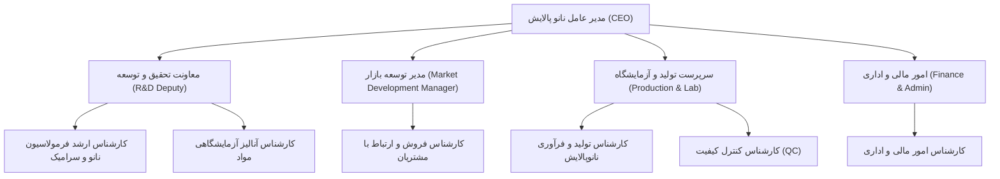
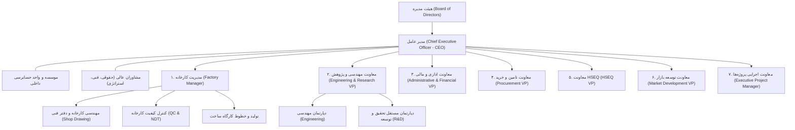

# چارت سازمانی رسمی، دپارتمان‌ها و کاتالوگ جامع سمت‌ها (Job Titles)
### شرکت مهندسی یورواسلات پارس و نانو پالایش (Euroslot Pars & NPCeram)
**مبتنی بر سند رسمی چارت سازمانی (ESP-CH-001-04)، ساختار مهندسی، عملیات کارخانه و تفکیک دو شرکت**

---

## ۱. مدل تفکیک چندسازمانی (Multi-Tenant Company Scoping)

در فرانت‌اند و بک‌اند، ساختار سازمان به سه حوزه کلیدی تقسیم شده است:
1. **سطح بالادستی هلدینگ و گروه (`holding` / دامنه دسترسی `all`):** جایگاه مدیران ارشد بالادستی (رئیس هیئت مدیره گروه و مدیرعامل هلدینگ) که بر هر دو مجموعه نظارت عالیه، حق تایید و مدیریت دارند. این دسترسی برای لیست سفید ایمیل‌های سازمانی مجاز (`HOLDING_EXECUTIVE_EMAILS`) فعال می‌گردد.
2. **شرکت مهندسی یورواسلات پارس (`euroslot` / دامنه `@euroslotpars.com`):** سازمان اصلی شامل ۱۱ دپارتمان، ساختار مهندسی پکیج، صنایع سنگین نفت و گاز، عملیات کارخانه، خطوط ساخت و کنترل کیفیت (QC).
3. **شرکت نانو پالایش (`npceram` / دامنه `@npceram.com`):** ساختار چابک و متمرکز بر نانومواد، آزمایشگاه، تحقیق و توسعه فرمولاسیون و بازاریابی نانوپالایش.

---

## ۲. چارت سازمانی شرکت نانو پالایش (NPCeram)

### سمت‌های رسمی شرکت نانو پالایش (`npceram`):
* **مدیریت ارشد:**
  * مدیر عامل (Chief Executive Officer - CEO)
* **دپارتمان تحقیق و توسعه (`rAndD`):**
  * معاونت تحقیق و توسعه (R&D Deputy / Vice President)
  * کارشناس ارشد فرمولاسیون نانو و سرامیک (Senior Nanoceramics Formulation Specialist)
  * کارشناس آزمایشگاه و آنالیز مواد (Materials Analysis & Lab Specialist)
* **دپارتمان توسعه بازار (`marketDevelopment`):**
  * مدیر توسعه بازار (Market Development Manager)
  * کارشناس فروش و امور مشتریان (Sales & Client Specialist)
* **دپارتمان تولید و کنترل کیفیت (`factory` / تولید و آزمایشگاه):**
  * سرپرست تولید و آزمایشگاه نانو پالایش (Production & Lab Supervisor)
  * کارشناس تولید و فرآوری مواد (Processing & Production Specialist)
  * کارشناس کنترل کیفیت (QC Specialist)
* **دپارتمان مالی و اداری (`administrative`):**
  * کارشناس امور مالی و اداری (Finance & Administrative Specialist)

---

## ۳. چارت کلان شرکت یورواسلات پارس (Euroslot Pars)

---

## ۴. ماتریس دپارتمان‌های سازمانی سامانه

| شناسه دپارتمان (`id`) | نام فارسی دپارتمان | وضعیت در یورواسلات | وضعیت در نانو پالایش | شرح وظایف اصلی |
| :--- | :--- | :---: | :---: | :--- |
| `engineering` | مهندسی | ✅ فعال | ❌ غیرفعال | طراحی پایه و تفصیلی پکیج‌ها، پروسس، مکانیک و انتقال جرم |
| `rAndD` | تحقیق و توسعه (R&D) | ✅ فعال | ✅ فعال | پژوهش‌های نوین، CFD، فناوری مواد پیشرفته و فرمولاسیون نانو |
| `factory` | تولید و عملیات کارخانه | ✅ فعال | ✅ فعال | خطوط تولید، ماشین‌کاری، جوشکاری، انبار متریال و نت |
| `factoryDetail` | مهندسی کارخانه (دفتر فنی) | ✅ فعال | ❌ غیرفعال | شاپ دراوینگ، کاتینگ پلن، BOM کارگاهی و نقشه‌های ساخت |
| `factoryQc` | کنترل کیفیت کارخانه (QC) | ✅ فعال | ✅ ادغام در تولید | بازرسی جوش، NDT، متریال ورودی، پینتینگ و تشکیل MDR |
| `projectControl` | کنترل پروژه و امور قراردادها | ✅ فعال | ❌ غیرفعال | برنامه‌ریزی و کنترل پروژه (PPC)، مستندات مهندسی (DCC) و قراردادها |
| `marketDevelopment` | توسعه بازار و فروش | ✅ فعال | ✅ فعال | بازاریابی مهندسی، فروش داخلی/خارجی، مناقصات و برآورد قیمت |
| `procurement` | تامین و تدارکات بازرگانی | ✅ فعال | ❌ هلدینگ | خرید متریال تخصصی داخلی و خارجی، سورسینگ و ترخیص گمرک |
| `administrative` | امور مالی و اداری | ✅ فعال | ✅ فعال | حسابداری، مالی، خزانه، امور حقوقی، منابع انسانی و رفاه |
| `it` | فناوری اطلاعات و ارتباطات | ✅ فعال | ❌ هلدینگ | زیرساخت شبکه، امنیت اطلاعات، سرورها، پشتیبانی و سامانه ERP |
| `hseq` | ایمنی، بهداشت و تضمین کیفیت | ✅ فعال | ❌ هلدینگ | نظارت بر ایمنی کارگاهی، الزامات محیط زیستی و تضمین کیفیت QA |

---

## ۵. دپارتمان مهندسی یورواسلات (`engineering`) به تفکیک بخش‌ها

### ۵.۱. مدیریت ارشد دپارتمان مهندسی
* مدیر دپارتمان مهندسی (Engineering Manager)
* دستیار / معاون مدیر مهندسی (Assistant / Engineering Deputy)

### ۵.۲. بخش مهندسی پکیج‌های فرآیندی (Package Engineering Section)
* رئیس بخش مکانیک پکیج (Package Mech. Dep. Head)
* دستیار / معاون بخش مکانیک پکیج (Package Mech. Assistant)
* کارشناس مهندسی مکانیک پکیج (Package Mech. Expert)
* رئیس بخش فرآیند / پروسس پکیج (Package Process Dep. Head)
* کارشناس مهندسی فرآیند پکیج (Package Process Expert)
* **کارشناسان بخش‌های کمکی و تخصصی پکیج:**
  * کارشناس تجهیزات دوار (Rotary Equipment Specialist)
  * کارشناس ابزار دقیق و کنترل (Instrumentation Specialist)
  * کارشناس تحلیل تنش و پایپینگ (Piping Stress & Layout Specialist)
  * کارشناس سیستم‌های الکتریکال و برق صنعتی (Electrical Specialist)
  * کارشناس محاسبات سازه و سیویل (Civil & Structural Specialist)
  * کارشناس سیستم‌های کنترل و پی‌ال‌سی (PLC & Control Systems Specialist)

### ۵.۳. بخش انتقال جرم و جداسازی (Mass Transfer / Separation Section)
* رئیس بخش مکانیک انتقال جرم و جداسازی (Mass Transfer Mech. Dep. Head)
* دستیار / معاون بخش مکانیک انتقال جرم (Mass Transfer Mech. Assistant)
* کارشناس مهندسی مکانیک جداسازی و انتقال جرم (Mass Transfer Mech. Expert)
* رئیس بخش پروسس و فرآیند انتقال جرم (Mass Transfer Process Dep. Head)
* کارشناس مهندسی شیمی و فرآیند انتقال جرم (Mass Transfer Process Expert)

### ۵.۴. بخش اینترنال‌های راکتور و فیلتراسیون (Reactor Internals & Filtration Section)
* رئیس بخش مکانیک راکتور و فیلتراسیون (Reactor & Filtration Mech. Dep. Head)
* دستیار / معاون بخش مکانیک راکتور و فیلتراسیون (Reactor & Filtration Mech. Assistant)
* کارشناس مهندسی مکانیک راکتور و فیلتراسیون (Reactor & Filtration Mech. Expert)
* رئیس بخش پروسس راکتور و فیلتراسیون (Reactor & Filtration Process Dep. Head)
* کارشناس مهندسی شیمی و فرآیند راکتور و فیلتراسیون (Reactor & Filtration Process Expert)

### ۵.۵. بخش طراحی محصول و مدل‌سازی CAD
* سرپرست بخش طراحی محصول (Product Design Section Supervisor)
* کارشناس ارشد مدل‌سازی سه‌بعدی و CAD (Senior 3D CAD Modeler)
* نقشه‌کش صنعتی و درفتس‌من (Industrial Draftsman)

---

## ۶. عملیات و دپارتمان‌های کارخانه یورواسلات

### ۶.۱. مهندسی کارخانه و دفتر فنی (`factoryDetail`)
* سرپرست دفتر فنی کارخانه (Factory Technical Office Supervisor)
* کارشناس ارشد مهندسی دیتیل ساخت / شاپ دراوینگ (Senior Shop Detail Engineer)
* کارشناس شاپ دراوینگ و تبدیل نقشه‌های مهندسی به نقشه‌های ساخت کارگاهی
* کارشناس کاتینگ پلن و بهینه‌سازی برش متریال (Cutting Plan & Nesting Specialist)
* کارشناس تهیه پارت‌لیست ساخت و BOM کارگاهی (Manufacturing BOM Specialist)
* نقشه‌کش و مدل‌ساز کارگاهی کارخانه (Factory CAD Draftsman)

### ۶.۲. کنترل کیفیت کارخانه (`factoryQc`)
* سرپرست کنترل کیفیت کارخانه (Factory Quality Control Supervisor)
* کارشناس کنترل کیفیت ساخت و ابعادبرداری (Fabrication & Dimensional QC Specialist)
* بازرس جوش و اتصالات (Welding Inspector - CWI / CSWIP)
* کارشناس آزمون‌های غیرمخرب (NDT Level II Specialist - PT, MT, UT, RT)
* بازرس کنترل کیفیت قطعات ورودی و متریال (Incoming Material QC Inspector)
* بازرس رنگ و پوشش‌های سطحی (Painting & Coating Inspector)
* کارشناس تدوین مدارک و پرونده کیفی نهایی (Final Dossier / MDR Specialist)

### ۶.۳. مدیریت تولید، سرپرستان کارگاه و خطوط ساخت (`factory`)
* مدیر کارخانه (Factory Manager)
* سرپرست تولید کارخانه (Factory Production Supervisor)
* سرپرست کارگاه ساخت (Workshop Supervisor)
* سرپرست برنامه‌ریزی و کنترل تولید کارخانه (Production Planning & Control Supervisor)
* کارشناس برنامه‌ریزی و کنترل تولید کارخانه (Production Planning Specialist)
* سرپرست انبارها و کنترل موجودی متریال (Factory Warehouses Supervisor)
* مسئول انبار متریال و قطعات نیمه‌ساخته (Raw Materials Warehouse Keeper)
* سرپرست نگهداری و تعمیرات نت (Maintenance Supervisor)
* تکنسین برق و مکانیک ماشین‌آلات کارخانه (Machinery Maintenance Technician)
* **مسئولین ایستگاه‌ها و خطوط تولید تخصصی:**
  * مسئول خط ماشین‌کاری و تراشکاری CNC
  * مسئول خط جوشکاری تخصصی آرگون و تیگ
  * مسئول ایستگاه مقاومت الکتریکی و نقطه‌جوش
  * مسئول خط مونتاژ قطعات و اینترنال‌های صنعتی
  * مسئول واحد اسیدشویی و پاسیویشن شیمیایی
  * مسئول واحد بسته‌بندی، پالت‌بندی و نجاری صنعتی
  * سرپرست تیم بازرسی، نصب و تست در سایت مشتری

---

## ۷. دپارتمان فناوری اطلاعات و ارتباطات (`it`)
* مدیر فناوری اطلاعات (IT Manager)
* سرپرست زیرساخت، شبکه و امنیت (Network & Infrastructure Supervisor)
* کارشناس ارشد سرور و شبکه‌های صنعتی (System & Network Administrator)
* کارشناس امنیت سایبری و حفاظت داده‌ها (Cybersecurity Specialist)
* کارشناس پشتیبانی سیستم‌ها و هلپ‌دسک (IT Support / Helpdesk Specialist)
* کارشناس توسعه نرم‌افزار، سامانه‌های داخلی و دیتابیس (ERP & Software Developer)

---

## ۸. سایر دپارتمان‌های ستادی و پروژه‌ای یورواسلات

### ۸.۱. کنترل پروژه و امور قراردادها (`projectControl`)
* معاونت اجرایی پروژه‌ها / مدیر ارشد پروژه‌ها (Executive Project Manager)
* مدیر برنامه‌ریزی و کنترل پروژه (PPC Manager)
* معاون مدیر کنترل پروژه (PPC Deputy)
* کارشناس ارشد برنامه‌ریزی و کنترل پروژه (Senior PPC Specialist)
* کارشناس مرکز اسناد و مدارک فنی و مهندسی (DCC Specialist)
* کارشناس امور قراردادها و پیمانکاران (Contracts Specialist)

### ۸.۲. توسعه بازار و فروش مهندسی (`marketDevelopment`)
* معاونت توسعه بازار (Market Development VP)
* مدیر توسعه بازار و فروش (Market Development Manager)
* معاون مدیر فروش (Sales Deputy)
* مدیر فروش مهندسی تجهیزات (Engineering Sales Manager)
* کارشناس مناقصات، پروپوزال و برآورد قیمت (Tenders & Cost Estimation Specialist)
* کارشناس بازاریابی و امور مشتریان (Marketing & Client Specialist)

### ۸.۳. تامین و خرید (`procurement`)
* معاونت تامین و خرید (Procurement VP)
* مدیر تامین و تدارکات (Procurement Manager)
* معاون مدیر خرید (Procurement Deputy)
* کارشناس خرید خارجی و سورسینگ بین‌المللی (Foreign Sourcing Specialist)
* کارشناس خرید متریال داخلی و فولاد (Domestic Purchasing Specialist)
* کارشناس امور بازرگانی، گمرک و ترخیص کالا (Commercial & Customs Specialist)

### ۸.۴. مالی و اداری (`administrative`)
* معاونت اداری و مالی (Administrative & Financial VP)
* مدیر مالی و حسابداری (Financial Manager)
* معاون مدیر مالی (Financial Deputy)
* رئیس حسابداری صنعتی و بهای تمام‌شده (Cost Accounting Head)
* کارشناس حسابداری عمومی و دریافت و پرداخت (General Accountant)
* سرپرست امور بانک، اعتبارات و تسهیلات (Banking & Credits Supervisor)
* مدیر امور اداری و منابع انسانی (HR & Admin Manager)
* کارشناس منابع انسانی، آموزش و کارگزینی (HR & Personnel Specialist)
* کارشناس امور حقوقی و ثبتی (Legal Specialist)
* سرپرست خدمات اداری و پشتیبانی عمومی (General Admin Services Supervisor)

### ۸.۵. ایمنی، بهداشت و تضمین کیفیت (`hseq`)
* معاونت HSEQ (HSEQ VP)
* سرپرست تضمین کیفیت (Quality Assurance - QA Supervisor)
* سرپرست ایمنی، بهداشت حرفه‌ای و محیط زیست (HSE Supervisor)
* افسر ایمنی کارگاه و سایت (Safety Officer)
