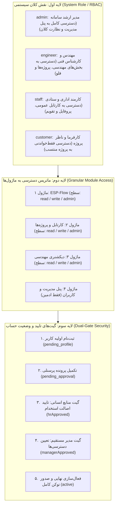

# مستند فنی نقش‌ها، سطوح دسترسی و معماری امنیت دوگانه (RBAC & PBAC)
### پورتال سازمانی یورو اسلات پارس و نانو پالایش (Euroslot Pars & NPCeram)

این گزارش فنی نحوه تفکیک و تعیین **نقش‌های سیستمی (System Roles)**، **ماتریس دسترسی ماژولار (Modular Permissions Matrix)** و **فرآیند تایید امنیتی دوگانه (Dual-Gate Security)** را تشریح می‌کند و نشان می‌دهد چگونه دسترسی‌های کاربر مستقل از عنوان شغلی (Job Title) توسط سرور تعیین و توسط کلاینت اعمال می‌شوند.

---

## ۱. تفکیک سه مفهوم کلیدی: سمت، نقش و سطح دسترسی

| مفهوم | فیلد در سیستم | تعریف و کارکرد | مرجع تصمیم‌گیرنده |
| :--- | :--- | :--- | :--- |
| **سمت سازمانی (Job Title)** | `jobTitle` | عنوان استخدامی و پرسنلی فرد در شرکت (مانند *کارشناس مکانیک* یا *مدیر خرید*). فقط در چارت، فرم‌ها و امضاها کاربرد دارد و مستقیماً تعیین‌کننده دسترسی فنی نیست. | منابع انسانی (HR) بر اساس حکم کارگزینی |
| **نقش کلان سیستمی (System Role)** | `role` | دسته‌بندی امنیتی کلی کاربر در پلتفرم (`admin`, `engineer`, `staff`, `customer`). | سرور و توکن احراز هویت |
| **ماتریس دسترسی ماژولار (Module Access)** | `modulesAccess` | دسترسی تفکیکی، دندانه‌ای و بر اساس لایسنس به هر منو، صفحه و ابزار با سطوح اختیارات (`read`, `write`, `admin`). | مدیر مستقیم فرد و ادمین سیستم در گیت تایید |

---

## ۲. نمودار معماری سه‌لایه دسترسی و تایید هویت



---

## ۳. لایه اول: نقش‌های کلان سیستمی (System Roles)

فیلد `role` در توکن سشن کاربر مشخص‌کننده دامنه اختیارات کلان است:

### ۳.۱. نقش `admin` (مدیر ارشد سامانه)
* دسترسی کامل به پنل مدیریت (`/admin`).
* مشاهده و ویرایش جدول کلیه کاربران سازمان و وضعیت آنلاین/آفلاین آن‌ها.
* بررسی و تصمیم‌گیری درباره درخواست‌های حساب جدید در کارتابل درخواست‌ها (`AdminRequests`).
* تخصیص مجدد نقش‌ها، بازنشانی رمز عبور و مسدودسازی حساب‌ها.
* دسترسی به لاگ‌های تغییرات و ماتریس هیت‌مپ فعالیت تیم‌ها.

### ۳.۲. نقش `engineer` (مهندس و کادر فنی)
* دسترسی به محیط فضای کاری پروژه‌ها (`/dashboard/projects`) و مستندات مهندسی.
* دسترسی به نرم‌افزار مهندسی نمودارها و فرآیند (`/ESP-Flow`).
* ثبت، تحویل، پیوست مدارک و ثبت زمان (Time Tracking) روی تسک‌های مهندسی.
* مشاهده و نشان‌گذاری در دیکشنری تخصصی و پایگاه دانش آیا می‌دانید.

### ۳.۳. نقش `staff` (کارمند عمومی / ستادی)
* دسترسی به پورتال پرسنلی و کارتابل عمومی وظایف.
* مدیریت یادداشت‌های شخصی، لینک‌های اختصاصی و ساعت جهانی.
* مشاهده و ویرایش پرونده فردی، مشخصات بیمه و افراد تحت تکفل.

### ۳.۴. نقش `customer` (کارفرما / نماینده پیمانکار)
* دسترسی ایزوله‌شده و محدود به پروژه‌هایی که شرکت کارفرما در آن طرف قرارداد است.
* امکان بازبینی نقشه‌های نهایی، دانلود مدارک تاییدشده و ثبت کامنت در تسک‌های مشترک.
* عدم دسترسی به سایر پروژه‌ها، اسناد مالی داخلی و اطلاعات پرسنلی شرکت.

---

## ۴. لایه دوم: ماتریس تفکیکی دسترسی به ماژول‌ها (`modulesAccess`)

با توجه به این‌که دو نفر با یک نقش مشترک (مثلاً هر دو `engineer`) ممکن است در پروژه‌ها یا بخش‌های متفاوتی کار کنند، سامانه از یک ماتریس دندانه‌ای (Granular Matrix) استفاده می‌کند.

### ۴.۱. مدل داده‌ای ماتریس در API و دیتابیس
```typescript
export interface UserModuleAccess {
  moduleId: string;                           // آدرس صفحه یا شناسه گروه (مثلاً '/ESP-Flow' یا '/dashboard/projects')
  hasAccess: boolean;                          // آیا کاربر به این ماژول دسترسی دارد؟
  accessLevel: 'read' | 'write' | 'admin';     // سطح اختیارات داخل ماژول
  hoursSpent?: string;                         // زمان صرف‌شده در این ماژول
  usagePercentage?: number;                    // درصد فعالیت در این ماژول
}
```

### ۴.۲. شرح سطوح اختیارات سه‌گانه (`accessLevel`)
1. **سطح `read` (فقط‌خواندنی):**
   * کاربر می‌تواند صفحات ماژول را باز کند و نقشه‌ها، فرم‌ها و اطلاعات را بخواند.
   * دکمه‌های ایجاد، ویرایش، حذف یا تغییر وضعیت برای کاربر مخفی یا غیرفعال (Disable) هستند.
2. **سطح `write` (ثبت و اقدام):**
   * کاربر علاوه بر خواندن، می‌تواند وظیفه جدید ثبت کند، نقشه بارگذاری کند، کامنت بگذارد و وضعیت پیشرفت تسک را تغییر دهد.
3. **سطح `admin` (مدیریت درون‌ماژول):**
   * کاربر اختیار بستن پروژه، حذف آیتم‌ها، انتصاب اعضای تیم و صدور تاییدیه‌های نهایی در آن ماژول را دارد.

### ۴.۳. نحوه اعمال در فرانت‌اند
* **کنترل منو و سایدبار:** کامپوننت ناوبری آیتم‌هایی که `hasAccess: false` دارند را از منوی سایدبار و نتایج جستجوی سریع حذف می‌کند.
* **گیت صفحات و روت‌ها (`AuthGate`):** در صورت ورود مستقیم با URL، سیستم دسترسی کاربر به آن مسیر را بررسی کرده و در صورت عدم مجاز بودن، صفحه خطای ۴۰۳ یا هدایت به داشبورد را نمایش می‌دهد.
* **دکمه‌های فرم‌ها و کارتابل‌ها:** کامپوننت‌ها با بررسی `accessLevel` تصمیم می‌گیرند دکمه‌هایی مانند *«ایجاد تسک جدید»* یا *«تایید شاپ دراوینگ»* فعال باشد یا خیر.

---

## ۵. لایه سوم: مکانیزم امنیت تایید دوگانه (Dual-Gate Security)

برای جلوگیری از دسترسی افراد غیرمجاز و انطباق با الزامات سازمانی یورو اسلات، فعال‌سازی حساب کاربری طی فرآیند تایید دو مرحله‌ای صورت می‌پذیرد:

### ۵.۱. چرخه وضعیت حساب کاربری (`accountStatus`)

```
[ثبت‌نام اولیه] 
      │
      ▼
[pending_profile]  ──(تکمیل فرم پرونده پرسنلی)──►  [pending_approval]
                                                           │
                                                           ▼
                                                ┌─────────────────────┐
                                                │  گیت ۱: تایید HR    │
                                                │ (صحت استخدام و مدارک) │
                                                └──────────┬──────────┘
                                                           │
                                                           ▼
                                                ┌─────────────────────┐
                                                │  گیت ۲: تایید مدیر  │
                                                │ (تعیین دسترسی ماژول) │
                                                └──────────┬──────────┘
                                                           │
                                                           ▼
                                                       [active]
                                                (ورود مجاز به سامانه)
```

### ۵.۲. جزئیات گیت‌های تایید
1. **گیت اول - منابع انسانی (`hrApproved`):**
   * کارشناس یا مدیر اداری در پنل ادمین درخواست را بازبینی می‌کند.
   * کد ملی، شماره پرسنلی، نوع قرارداد، شرکت (`euroslot` یا `npceram`) و مدارک احراز هویت را بررسی و تایید می‌نماید:
     ```http
     POST /api/v1/admin/requests/{id}/approve-hr
     Body: { "notes": "مدارک استخدامی تایید شد." }
     ```
2. **گیت دوم - مدیر مستقیم (`managerApproved`):**
   * مدیر مستقیم متقاضی، دپارتمان دقیق، نقش سیستمی (`role`) و ماتریس دسترسی به ماژول‌های مجاز فرد (`modulesAccess`) را تعیین و فعال‌سازی می‌کند:
     ```http
     POST /api/v1/admin/requests/{id}/approve-manager
     Body: {
       "role": "engineer",
       "tempPassword": "...",
       "modulesAccess": [
         { "moduleId": "/dashboard/projects", "hasAccess": true, "accessLevel": "write" },
         { "moduleId": "/ESP-Flow", "hasAccess": true, "accessLevel": "read" }
       ]
     }
     ```
3. **فعال‌سازی نهایی:** حساب به وضعیت `active` تغییر یافته و ایمیل حاوی نام کاربری و دسترسی‌ها به صورت خودکار برای پرسنل ارسال می‌گردد.

---

## ۶. طراحی جداول دیتابیس در بک‌اند (Database Schema)

جهت ذخیره‌سازی این منطق در دیتابیس رابطه‌ای (PostgreSQL / MySQL)، جداول زیر پیاده‌سازی می‌شوند:

```sql
-- ۱. جدول کاربران پایه
CREATE TABLE users (
    id UUID PRIMARY KEY DEFAULT gen_random_uuid(),
    email VARCHAR(255) UNIQUE NOT NULL,
    full_name_fa VARCHAR(255),
    full_name_en VARCHAR(255),
    role VARCHAR(50) NOT NULL DEFAULT 'staff', -- 'admin', 'engineer', 'staff', 'customer'
    account_status VARCHAR(50) NOT NULL DEFAULT 'pending_profile', -- 'pending_profile', 'pending_approval', 'active', 'rejected'
    company_id VARCHAR(50) NOT NULL, -- 'euroslot', 'npceram'
    department_id VARCHAR(100),
    job_title VARCHAR(255),
    manager_user_id UUID REFERENCES users(id),
    hr_approved BOOLEAN DEFAULT FALSE,
    manager_approved BOOLEAN DEFAULT FALSE,
    created_at TIMESTAMP WITH TIME ZONE DEFAULT NOW()
);

-- ۲. جدول کاتالوگ ماژول‌های سامانه
CREATE TABLE app_modules (
    id VARCHAR(100) PRIMARY KEY, -- مثال: '/dashboard/projects', '/ESP-Flow'
    title_fa VARCHAR(255) NOT NULL,
    title_en VARCHAR(255) NOT NULL,
    category VARCHAR(100),
    is_default_active BOOLEAN DEFAULT FALSE
);

-- ۳. ماتریس تفکیکی دسترسی کاربر به ماژول‌ها
CREATE TABLE user_module_permissions (
    id UUID PRIMARY KEY DEFAULT gen_random_uuid(),
    user_id UUID NOT NULL REFERENCES users(id) ON DELETE CASCADE,
    module_id VARCHAR(100) NOT NULL REFERENCES app_modules(id) ON DELETE CASCADE,
    has_access BOOLEAN NOT NULL DEFAULT TRUE,
    access_level VARCHAR(20) NOT NULL DEFAULT 'read', -- 'read', 'write', 'admin'
    updated_at TIMESTAMP WITH TIME ZONE DEFAULT NOW(),
    UNIQUE(user_id, module_id)
);
```

---

## ۷. اندپوینت‌های API مرتبط با مدیریت نقش‌ها و دسترسی‌ها

| ردیف | متد | اندپوینت (Endpoint) | شرح عملیات |
| :---: | :---: | :--- | :--- |
| **۱** | `GET` | `/api/v1/users/me` | دریافت مشخصات کاربر به همراه `role`، `accountStatus` و `modulesAccess` |
| **۲** | `GET` | `/api/v1/admin/users/{id}/permissions` | دریافت لیست ماژول‌ها و سطوح دسترسی یک کاربر خاص توسط ادمین |
| **۳** | `PUT` | `/api/v1/admin/users/{id}/permissions` | به‌روزرسانی ماتریس دسترسی‌های ماژولار کاربر توسط ادمین یا مدیر |
| **۴** | `POST`| `/api/v1/admin/requests/{id}/approve-hr` | ثبت تاییدیه مرحله اول (منابع انسانی) برای درخواست عضویت |
| **۵** | `POST`| `/api/v1/admin/requests/{id}/approve-manager` | ثبت تاییدیه نهایی مدیر مستقیم و تخصیص اولیه ماتریس دسترسی‌ها |
| **۶** | `POST`| `/api/v1/admin/requests/{id}/reject` | رد درخواست حساب کاربری با ذکر علت |

---

## ۸. معماری دسترسی مدیران ارشد بالادستی هلدینگ (Holding Executive Scope)

### ۸.۱. چالش دسترسی فرابخشی (Cross-Company Management)
در ساختارهای چندشرکتی (Multi-Tenant)، کاربران عادی بر اساس دامنه ایمیل (`@euroslotpars.com` یا `@npceram.com`) تنها به داده‌های شرکت متبوع خود دسترسی دارند. اما مدیر بالادستی (رئیس هیئت مدیره گروه / مدیرعامل هلدینگ) باید بتواند بدون نیاز به دو اکانت مجزا یا لاگ‌اوت کردن:
1. اطلاعات، پروژه‌ها، پرسنل و کارتابل‌های **هر دو شرکت** را در یک نما یا به صورت سوییچینگ ببیند.
2. به عنوان **مدیر مستقیم (Direct Manager)** برای هر دو مدیرعامل (یورواسلات و نانوپالایش) عمل کرده و تاییدات گیت دوم را صادر نماید.

### ۸.۲. لیست سفید ایمیل‌های مجاز هلدینگ (Executive Email Whitelist)
دسترسی به این جایگاه بر اساس یک لیست سفید امنیتی (Whitelist) در کلاینت و سرور مدیریت می‌شود:

```typescript
export const HOLDING_EXECUTIVE_EMAILS: string[] = [
  "chairman@euroslotpars.com",
  "ceo@euroslotpars.com",
  "director@euroslotpars.com",
  "holding@euroslotpars.com",
  "group.ceo@euroslotpars.com",
  "board@euroslotpars.com",
  "s.jalili@euroslotpars.com",
  "saeed@euroslotpars.com",
];
```

* **قانون تشخیص خودکار:**
  هر کاربری که با یکی از این ایمیل‌ها یا پیشوندهای `chairman@*`، `holding@*` یا `group.*@*` وارد سامانه شود یا درخواست حساب دهد:
  * شناسه شرکت او به صورت خودکار به `holding` تخصیص می‌یابد.
  * دامنه دسترسی او `companyScope: 'all'` خواهد بود.
  * در جدول پرسنل و کارتابل با نشان اختصاصی **«هلدینگ و گروه (هر دو شرکت)»** متمایز می‌شود.

### ۸.۳. عناوین شغلی تعریف‌شده برای مدیران ارشد بالادستی
در کاتالوگ سازمان، ۳ سمت بالادستی با شناسه شرکت‌های `["euroslot", "npceram", "holding"]` ثبت شده‌اند:
1. **رئیس هیئت مدیره گروه (Group Chairman of the Board):** دارای اختیار نظارت عالیه بر هیئت مدیره هر دو شرکت.
2. **مدیرعامل گروه / هلدینگ (Group CEO / Managing Director):** مسئول هماهنگی اجرایی، استراتژیک و مالی هر دو مجموعه.
3. **عضو هیئت مدیره گروه (Group Board Member):** اعضای ارشد حاکمیتی هلدینگ.

### ۸.۴. سازوکار نمایش در فرانت‌اند
* **در فیلترهای جداول (AdminUsersTable):** دکمه فیلتر سه‌گانه `[ همه شرکت‌ها | یورواسلات پارس | نانو پالایش | هلدینگ و گروه ]` فعال است.
* **در انتخاب مدیر مستقیم (Direct Manager):** در هر دو شرکت، سمت «رئیس هیئت مدیره گروه» در صدر گزینه‌ها قرار دارد تا مدیران عامل بتوانند ایشان را به عنوان مدیر مستقیم انتخاب کنند.

